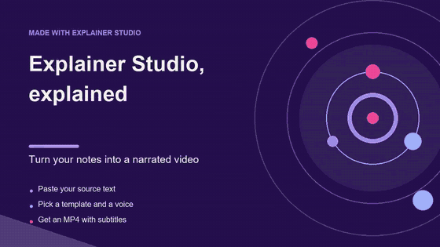
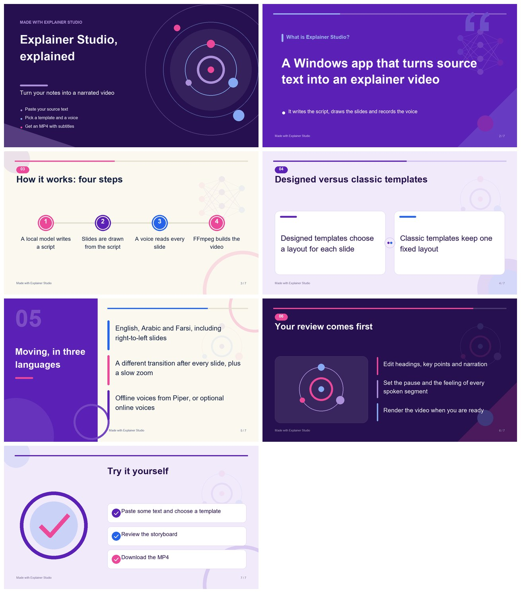
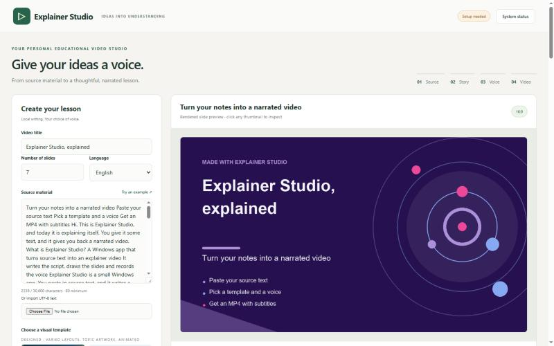
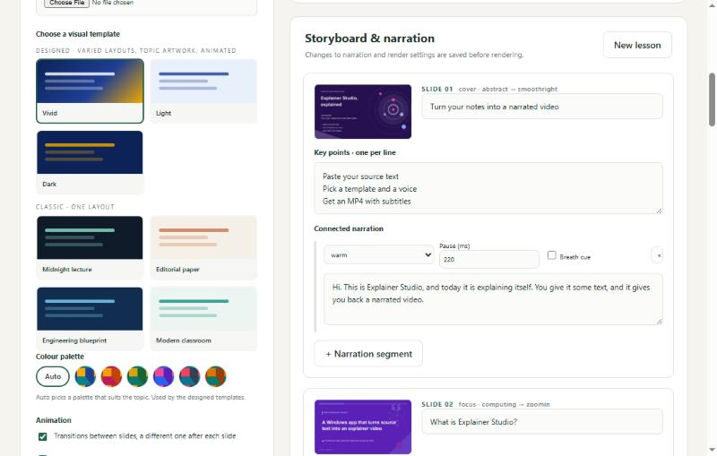
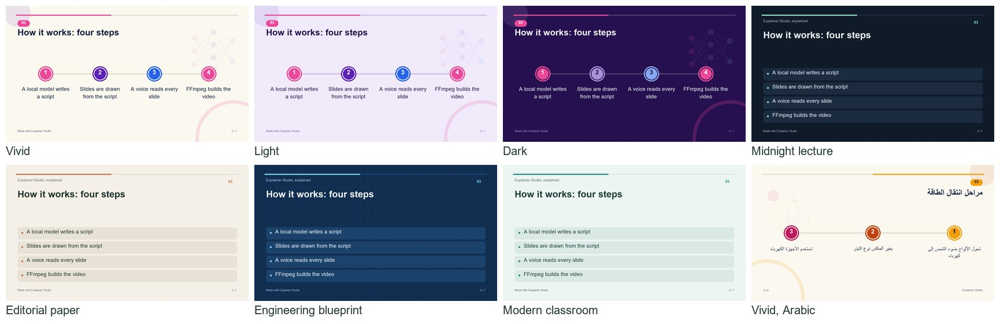

# Explainer Studio

Paste some text, pick a template, and get a narrated MP4. The studio writes a script from your text, draws the slides, records a voice and joins it all into a video with subtitles. It runs on your own Windows machine, and the writing and the voices can work fully offline once set up.



## The sample video explains the studio

We fed the studio a short description of itself. The result is an 83 second video: [docs/sample-explainer.mp4](docs/sample-explainer.mp4), with [subtitles](docs/sample-explainer.srt). It uses the Vivid template and the offline English Piper voice. The input is [examples/explainer-studio-explained.json](examples/explainer-studio-explained.json), so you can see exactly what produced it.



## Install and run

1. Download or clone this folder somewhere you can write to.
2. Double-click **Start Studio.cmd**.
3. Wait. The first run downloads a private Python 3.11, the packages, a portable Ollama, the writing model and three voices. Plan for at least 12 GB of free disk space.
4. Your browser opens at http://127.0.0.1:8768. Keep the console window open while you work.

You don't need admin rights or an existing Python. Everything lives inside this folder: Python in `.runtime/`, packages in `.venv/`, models in `models/`. Your system Python and any Ollama you already run are left alone (the studio uses its own Ollama on port 11439).

After setup, generating a video works without internet. If a download fails, run the launcher again and it carries on. Setup stops with an error if a model, checksum or voice test fails. It never swaps in fake audio.

## Making a video



1. Enter a title, choose 2 to 20 slides, and paste 80 to 30,000 characters of source text (or load a `.txt` / `.md` file).
2. Choose the language (English, Arabic or Farsi), a template, and a voice.
3. Leave "review the storyboard" ticked if you want to edit before the video is made.
4. In the storyboard you can change every heading, key point and spoken sentence, plus the pause and feeling of each segment.
5. Press **Create MP4 with narration**. Template, palette, animation, voice, pace and size can still be changed at this point. Title, language and source can't, since the script depends on them.
6. Watch it in the page, then download the MP4, SRT, narration text or the whole project as a ZIP.



Projects are saved in `projects/` and show up in the library when you reopen the studio. If the browser page is reloaded during a job it reconnects. Cancelling waits for a running model or voice request to return; FFmpeg stops immediately.

## Templates



There are two kinds.

**Designed** (Vivid, Light, Dark). Each slide gets its own layout, chosen from what the slide says: a sequence word gives numbered steps, two points with comparison wording give side-by-side cards, a percentage in a key point is shown large, a definition gets a big statement, and so on. There are ten layouts in total. A topic recognised in the text (solar, water, biology, computing, health, environment, space, research, plus battery, database and cell) gets a simple vector illustration; anything else gets neutral artwork. Narration never invents data for a chart. You can pick one of six colour palettes or leave it on Auto, which picks one that suits the topic. The same layout or background never appears twice in a row, and the result is the same every time for the same storyboard.

Each designed slide also saves its artwork as an SVG next to the PNG, and `design.json` in the project records the layout, subject and transition of every slide.

**Classic** (Midnight lecture, Editorial paper, Engineering blueprint, Modern classroom). One fixed layout with fixed colours.

If text doesn't fit a layout, the slide falls back to a roomier one. If it fits none, the editor asks you to shorten it.

### Animation

The video is built in a single FFmpeg pass. Every slide drifts slowly (a 4.5% zoom), and a different transition leads into the next one, chosen from 16 FFmpeg `xfade` transitions (the directional ones are mirrored for Arabic and Farsi). The first slide fades in and the last fades out. Each narration ends with a short silence so the transition happens between sentences. Transitions and zoom can be switched off for plain cuts. Both work in all seven templates.

## Languages and voices

| Language | Offline voice (Piper) |
|---|---|
| English | `en_US-lessac-medium` |
| Arabic | `ar_JO-kareem-medium` (Jordanian accent) |
| Farsi | `fa_IR-amir-medium` |

Right-to-left slides are drawn right to left, with the text shaped correctly.

Piper is fast and works offline, but it isn't an acting model. The emotion label only changes the speed a little; punctuation and pauses do the rest. Preview the video and fix awkward sentences in the storyboard.

If you want a more expressive voice you can use an online one instead:

- **ElevenLabs v3**: needs your API key and a voice ID from your library. Supports emotion tags and an optional breath cue.
- **Azure Neural Speech**: needs your key and region. English Jenny supports speaking styles; the other voices only get pace and pitch changes.

Online voices send the narration text to that provider, and your account may be charged. API keys stay in memory, are never written to the project files or exports, and are cleared when you reload the page.

The optional breath setting adds a quiet synthesized air sound with Piper or Azure, and asks the model for an `[exhales]` cue with ElevenLabs. Results vary, so you can turn it off per segment.

Subtitles follow the length of each spoken segment. They are not aligned word by word.

## Command line

These two only need Pillow, not Ollama, a voice or FFmpeg.

```powershell
# draw the slides and a contact sheet from a storyboard file
.\.venv\Scripts\python.exe studio.py --preview examples\explainer-studio-explained.json --theme vivid --palette ocean

# add a storyboard file to the library, then edit and render it in the browser
.\.venv\Scripts\python.exe studio.py --import-storyboard examples\solar-lesson-ar.json --theme dark
```

`--preview` writes into `<file>-preview/` (or the folder given with `--out`). A storyboard file has this shape, which makes it easy to write one with any other model:

```json
{
  "version": 1,
  "language": "en",
  "title": "Solar energy, explained",
  "footer": "Your channel",
  "slides": [
    {
      "title": "Store energy for later",
      "bullets": ["A battery stores energy"],
      "segments": [{"text": "The battery stores energy for later use.", "emotion": "warm", "pause_ms": 200}]
    }
  ]
}
```

Other options: `--setup`, `--pull-small`, `--diagnose`, `--port`, `--no-browser`.

## What it runs on

The defaults are chosen for a laptop with an i7 and 8 GB of RAM and no GPU.

| Stage | What is used |
|---|---|
| Script | Qwen3-4B-Instruct-2507 (Q4_K_M) through Ollama. A smaller Qwen3 1.7B is available with `studio.py --pull-small` |
| Voice | Piper (offline), or ElevenLabs / Azure (online, optional) |
| Slides | Pillow, with `deck.py` and `visuals.py` holding the design rules. No image model |
| Video | FFmpeg from imageio-ffmpeg: H.264, AAC, 24 fps, 720p or 1080p |
| Interface | Python's built-in HTTP server and one embedded page. Nothing to build |

The writing model uses a 4,096-token context on the CPU with at most four threads. Long sources are summarised in pieces first, and each slide's prompt also sees the narration before it, so the script reads as one lesson. One job runs at a time, the model is unloaded before the voice starts, and images, audio and video are processed one after another.

The model's download size isn't the memory it needs; Windows, the browser and the model's working memory come on top. Close big programs on an 8 GB machine and start with 3 to 6 slides at 720p. We haven't measured speed or peak memory on a laptop, so there are no figures here.

## Good to know

- The studio listens on 127.0.0.1 only. It is a local tool, not something to put on a server.
- Script writing on a CPU can take several minutes per slide.
- Check AI-written facts and pronunciation before you share a video.
- Setup needs internet access to GitHub, PyPI, Hugging Face and Ollama's registry. If a proxy or firewall blocks one, fix that and run the launcher again.
- If the port is taken: `.venv\Scripts\python.exe studio.py --port 8770`.
- **System status** in the page shows which packages, models and voices are missing. Logs: `.runtime/ollama.log` for the model, `error.log` and `render.log` inside a project for failed jobs.
- On a machine without Arial, put `NotoSansArabic-Regular.ttf` and `NotoSansArabic-Bold.ttf` in a `fonts/` folder.

## Files

| File | What it is |
|---|---|
| `studio.py` | The pipeline, the web server and the embedded page |
| `deck.py` | Layouts, palettes, transitions and slide drawing |
| `visuals.py` | Reads what a slide is about and draws the vector artwork |
| `setup.ps1`, `Start Studio.cmd`, `requirements.txt` | Install and launch |
| `examples/` | Storyboard files, including the one behind the sample video |
| `docs/` | The sample video and the pictures in this README |
| `test_studio.py`, `test_design.py` | Tests |
| `RESEARCH.md`, `VALIDATION.md` | Why these models, and what has and hasn't been tested |

Run the tests with the project's own Python so the drawing tests are included (they are skipped without Pillow):

```powershell
.\.venv\Scripts\python.exe -m unittest -v test_studio.py test_design.py
```

Some tests replace the voice and FFmpeg with stand-ins. They check the logic and the files produced, not how the voice sounds.

## License

Explainer Studio is released under the **GNU General Public License v3.0** (see [LICENSE](LICENSE)). That fits Piper, the speech engine it uses, which is GPL-3.0-or-later.

This repository contains no model weights, voices or keys. Setup downloads them from their own sources and they keep their own licenses: the Piper voices (each model card is saved next to its voice), Qwen3, Ollama, FFmpeg, Pillow, NumPy, arabic-reshaper and python-bidi. Check those terms before you redistribute generated voices or videos commercially. ElevenLabs and Azure are covered by your account's terms. `RESEARCH.md` has more detail.

The sample video's voice is the Piper `en_US-lessac-medium` voice; see its model card for its terms.
